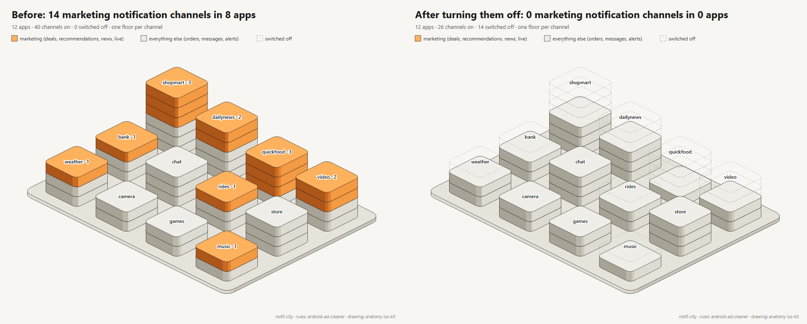
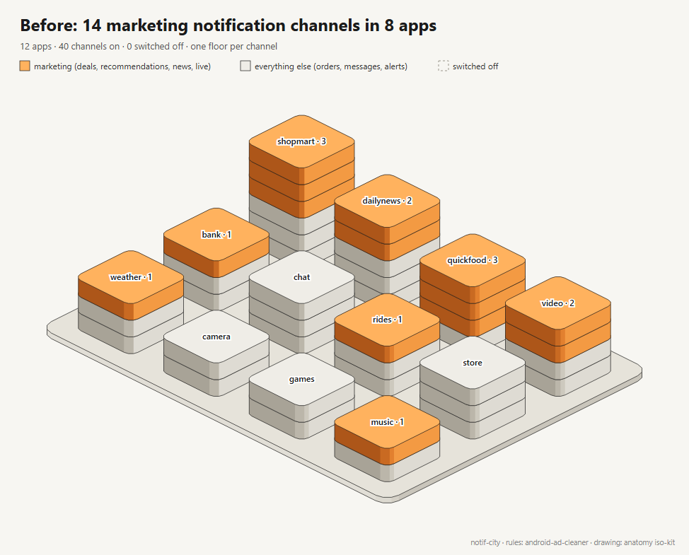
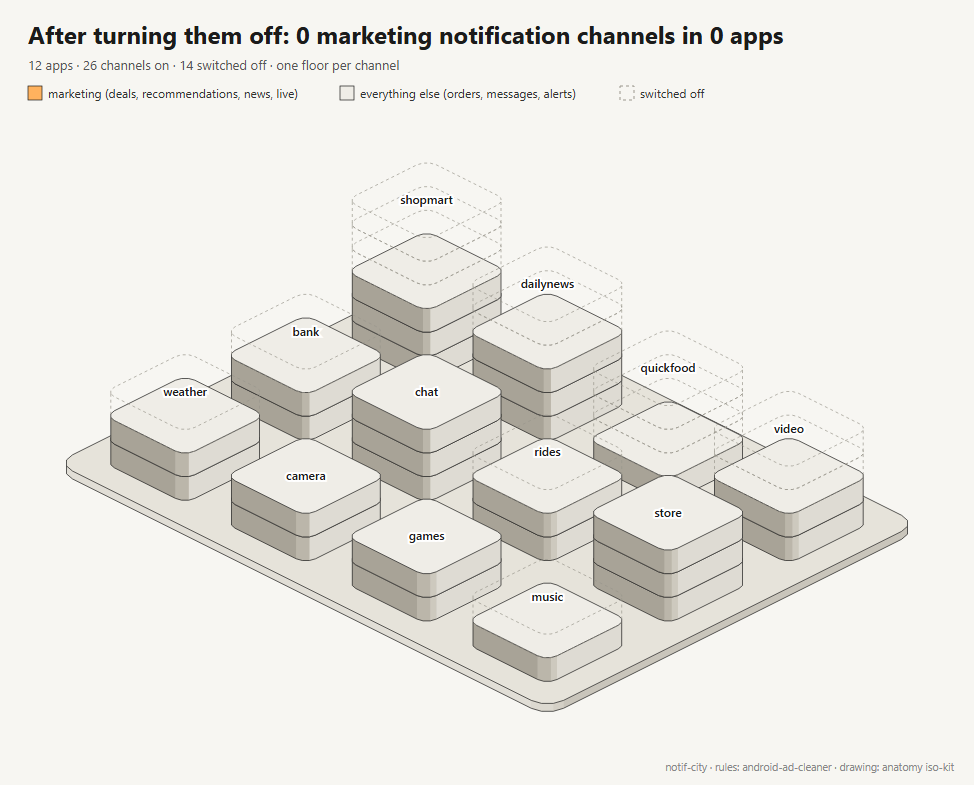

<div align="center">

# notif-city

**See which apps flood your Android phone with ads and deals, as a 3D city you can shrink.**

Every shopping, food and news app adds "deals", "recommended for you" and "live now" notification channels. Android lets you switch each one off, but it never shows you all of them at once. notif-city reads them over adb, read-only, and draws the result in the isometric style of [anatomy](https://github.com/wheresryan22/anatomy).

 

Works with **Claude Code** and **Codex**.



</div>

## Quick start
```bash
git clone https://github.com/Dodai0419/notif-city && cd notif-city
node notif_city.mjs --adb -o out          # phone plugged in with USB debugging on
```
No phone at hand? `node notif_city.mjs --demo -o out` uses a synthetic phone:
```
com.example.bank	marketing	Products and offers
com.example.dailynews	breaking	Breaking news
com.example.quickfood	lunch_push	Lunch deals
com.example.shopmart	promo_deals	Deals and promotions
com.example.video	live_push	直播推荐
...
14 marketing channels on in 8 apps (40 channels read)
wrote out/city.svg and out/channels.tsv
```
Node.js 18+ and adb. Nothing to install with npm. It only reads `dumpsys notification`; it never changes a setting on the phone.

## Gallery

| | |
|---|---|
|  | **Before.** One building per app, one floor per notification channel. ShopMart has 6 channels and 3 of them are marketing: deals, coupons, "recommended for you". QuickFood has 3 out of 4. Chat, Camera and Games have none. |
|  | **After.** The 14 channels were switched off on the phone and the dump was read again. The buildings stay in the same place; what was removed is drawn as dashed floors, so the picture shows how much went away. |
| [`docs/channels.tsv`](docs/channels.tsv) | **The list.** The same 14 channels as a tab-separated file: package, channel ID, name. Delete the lines you want to keep. [android-ad-cleaner](https://github.com/rddmwmddr/android-ad-cleaner)'s `chan_fast.py off` reads this exact format and switches them off for you. |

Both pictures come from `examples/demo-before.txt` and `examples/demo-after.txt`, made-up dumps in the real `dumpsys` layout.

## The problem
- Apps put ads into notification channels with names like "Offers near you" or "Picked for you", next to the order and security alerts you need.
- Android shows channels one app at a time, several taps deep. Nobody checks 80 apps.
- Turning off all notifications for an app also kills delivery updates and bank alerts.

## The solution
| Idea | Fixes |
|------|-------|
| **Read every channel in one adb call.** `dumpsys notification --noredact`, read-only. | No tapping through 80 settings pages. |
| **android-ad-cleaner's rules.** Marketing keywords in English and Chinese (deal, promo, recommend, news, live, coupon, 优惠, 推荐, 直播 ...), minus anything about orders, payments, security, calls, messages or alarms. The camera "photo spot" feature is protected. | Ads are found, the alerts you need are left alone. |
| **A city, not a table.** One building per app, one orange floor per marketing channel, dashed floors for what you switched off. | You see the worst apps at a glance and get a before/after picture. |
| **A list you can act on.** `channels.tsv` in the format android-ad-cleaner reads back. | From picture to cleanup in one step. |

## What counts as marketing
A channel is listed when it is switched on, not deleted, its app is not muted, its name or ID contains a marketing keyword, its name has none of the "keep" words, and it is not the camera photo-spot channel. These are android-ad-cleaner's rules, unchanged. They are keyword rules, so read the list: "Breaking news" or "Weather news" may be something you want.

## FAQ

**Does it change anything on my phone?**
No. It runs one command, `dumpsys notification --noredact`, which only reads. Switching channels off is up to you (long-press a notification, or Settings > Apps > the app > Notifications) or to android-ad-cleaner.

**Do I need root?**
No. USB debugging (Developer options) and `adb` on your computer are enough. `adb devices` should list the phone.

**Which phones?**
Any Android phone that exposes notification channels over adb, which means Android 8 and newer. The keyword list was written for Xiaomi, OPPO, OnePlus, vivo and Honor phones (Chinese channel names) and also has the English words most global apps use.

**Why is "Breaking news" on the list?**
The rules are keywords, not judgement: "news" is a marketing keyword because news feeds are how many apps push engagement. Delete the lines you want to keep from `channels.tsv` before you act on it.

**What is the camera "photo spot" exception?**
Some camera apps have a "find a photo spot" channel whose name contains "recommend". android-ad-cleaner protects it because users reported losing a feature they wanted; notif-city keeps that rule.

**Can I share my city picture?**
It shows package names of the apps on your phone. If that is private, use `--title` and crop, or share the demo.

## Use with Claude Code
```bash
/plugin marketplace add Dodai0419/notif-city
/plugin install notif-city@notif-city
```
Then ask: *"Which apps on my phone send me ads? Draw it."*

## Use with Codex (ChatGPT)
```bash
git clone https://github.com/Dodai0419/notif-city && cp -r notif-city/skills/* ~/.codex/skills/
```
Or copy `AGENTS.md` into your project root.

## Benchmarks
Windows 11, Node.js 24.20.0, `node bench/bench.mjs 50`, run 3 times.

| | android-ad-cleaner `chan_fast.py scan` (e2419d1) | notif-city |
|---|---|---|
| same marketing rows on upstream's own scan test cases | yes (4 cases from `tests/test_scan_startup.py`, `test_feedback_safety.py`, `test_release_regressions.py`) | yes, the same 4 cases in `tests/notif_city.test.mjs` |
| code needed for a read-only scan | `chan_fast.py` imports `fast.py`, `run.py`, `ui_session.py`, `troubleshooting.py`, `channel_policy.py`: 1,747 lines | `notif_city.mjs` 167 lines (scan, city and CLI) + `vendor/iso.mjs` 172 lines |
| packages needed for a read-only scan | `uiautomator2` (imported at start by `fast.py`) | none |
| parse + scan, demo dump (40 channels) | not measured | 0.23-0.33 ms |
| parse + scan, 300 apps / 3,000 channels | not measured | 9.2-9.8 ms |
| draw the city, 300 apps | no picture | 466-528 ms |
| whole CLI run, demo | not measured | 302-342 ms |

Upstream timings are "not measured": running upstream's code was not possible in the automated run that built this repo, so the comparison is the code and dependency count, plus upstream's own test cases.

## Inspired by
- [rddmwmddr/android-ad-cleaner](https://github.com/rddmwmddr/android-ad-cleaner) — the dumpsys parser and the marketing / keep / protected rules (ported), and the `channels.tsv` format.
- [wheresryan22/anatomy](https://github.com/wheresryan22/anatomy) — the isometric projection, extrusion and four-tone shading (`kit/iso-kit.mjs`, vendored).

## Roadmap
- [ ] Switch channels off from the picture (a confirm step per app).
- [ ] Group by app label instead of package name (`dumpsys package`).
- [ ] Animated SVG: floors drop away one by one between two dumps.

## License
MIT. Portions from the two projects above, see [NOTICE](NOTICE). The demo phone and its apps are made up.
